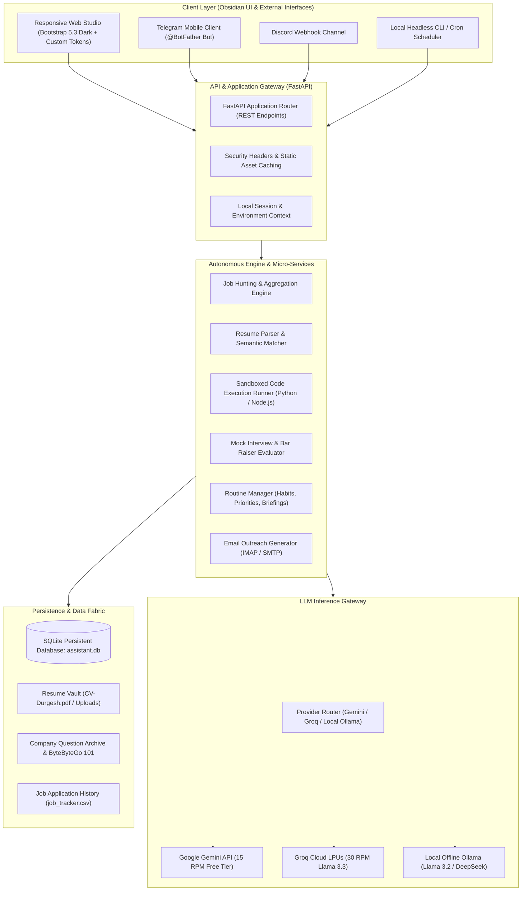
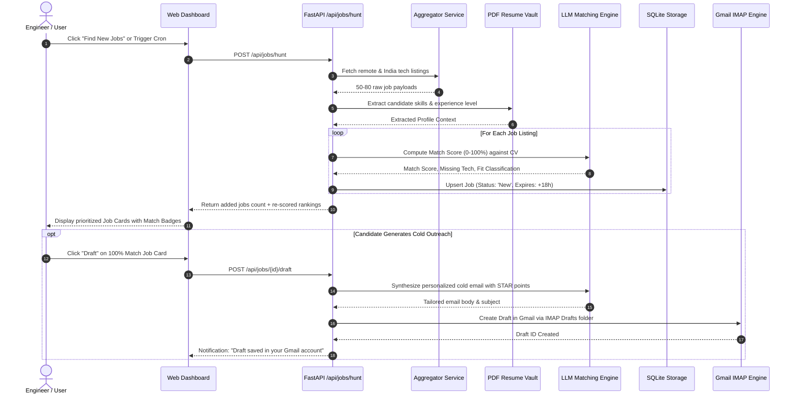
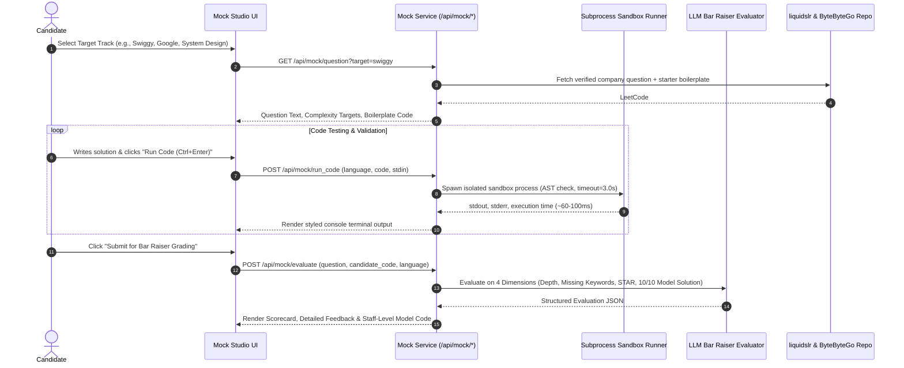
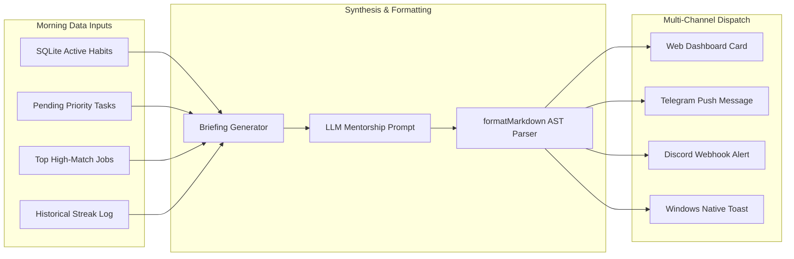
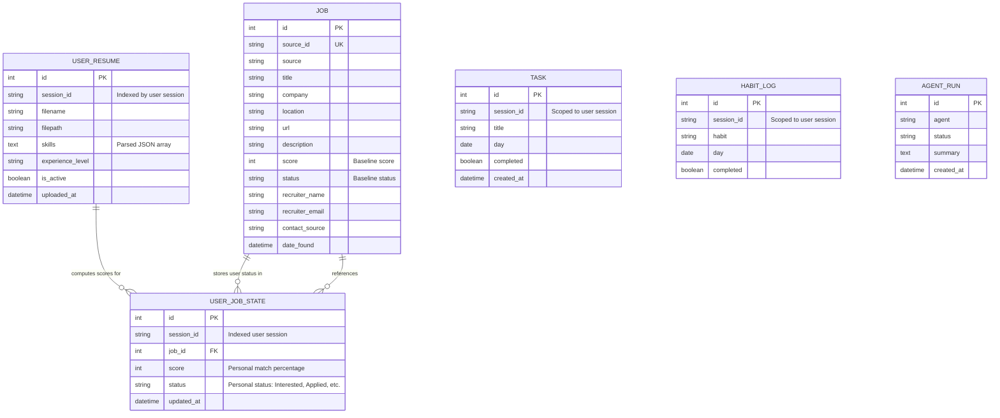

# Scout-AI — System Architecture & Production Engineering Specification
> **Document Version:** 2.4.0  
> **Status:** Production / Release Candidate  
> **Classification:** Technical Architecture & System Specification  
> **Target Audience:** Staff Engineers, DevOps, System Architects, Contributors  

---

## 1. Executive Summary

**Scout-AI** is an autonomous, event-driven personal career intelligence studio and staff-level interview simulator. It combines high-throughput asynchronous job crawling, semantic resume matching, a sandboxed multi-language code execution runtime, a 4-dimension technical Bar Raiser evaluation engine, and automated multi-channel briefing dispatch (Telegram, Discord, Gmail, Desktop).

Designed with strict zero-leakage security, the application maintains total separation between application code and runtime credentials via Pydantic environment validation (`.env`), persistent local SQLite storage with SQLAlchemy ORM, and AST-guarded sandboxed local code execution.



---

## 2. Core Workflows & End-to-End Sequence Architectures

### 2.1 Workflow 1: Autonomous Job Hunter & Semantic Matcher

The Job Hunter aggregates listings across 7 verified direct and aggregator sources (LinkedIn India, JSearch Aggregator, Himalayas, WeWorkRemotely, Remotive, Arbeitnow, Jobicy — with startup roles crawled via aggregator feeds), filters for calibrated entry-level / intern roles, deduplicates against the local database, scores candidate relevance using keyword taxonomy and temporal date-range heuristics, and enforces an 18-hour auto-clean lifecycle.



---

### 2.2 Workflow 2: Live Mock Interview Arena & Sandbox Compiler

The Mock Interview Simulator pulls verified real-world interview problems from the **liquidslr company archive** (Swiggy, NatWest, Google, Amazon, Meta) and architectural problems from **ByteByteGo 101**. The candidate writes solutions in an integrated Monaco/JetBrains-style code editor, runs test cases inside an isolated subprocess compiler, and receives 4-metric Bar Raiser grading.



#### 2.2.1 Multi-Tier Code Execution Sandbox & Zero-Trust Public Isolation

To protect host infrastructure against unauthorized access or denial-of-service during public code evaluation, Scout-AI enforces a 6-tier defense-in-depth isolation runtime:

1. **Static AST Analysis & Reflection Blocking (Pre-Execution):**
   - Python AST visitor verifies every syntax node before compilation.
   - Prohibits all host/OS modules: `os`, `subprocess`, `sys`, `shutil`, `socket`, `http`, `urllib`, `requests`, `ctypes`, `builtins`, `tempfile`, `pathlib`, `glob`, etc.
   - Prohibits unsafe built-ins: `eval`, `exec`, `compile`, `open`, `__import__`, `globals`, `locals`, `getattr`, `setattr`, `delattr`.
   - Blocks Python sandbox breakout dunders targeting introspection and prototype inheritance: `__class__`, `__subclasses__`, `__bases__`, `__mro__`, `__globals__`, `__builtins__`, `__code__`, `__closure__`, `__dict__`.
2. **Node.js / V8 Security Engine Flags:**
   - Regex token verification blocks `require('fs')`, `require('child_process')`, `process.exit`, `process.env`, `Function(`, etc.
   - Executes with `--no-addons` (disabling native C++ bindings).
   - Executes with `--disallow-code-generation-from-strings` (disabling `eval()` and `new Function()` at the V8 engine level).
   - Caps V8 heap with `--max-old-space-size=64` (64 MB memory ceiling).
3. **Python Isolated Mode & Network Poisoning:**
   - Executes via `python -I -B` (Isolated Mode): ignores `PYTHONPATH` and user `site-packages`, removing the current directory from `sys.path`.
   - Pre-injects a runtime preamble that explicitly sets `sys.modules['socket'] = None`, `sys.modules['urllib'] = None`, etc., rendering dynamic network imports inert.
4. **POSIX Kernel-Level Resource Limits (`resource` / `RLIMIT`):**
   - When deployed on Linux/Docker, `preexec_fn` enforces:
     - `RLIMIT_CPU`: 3.0s hard CPU limit.
     - `RLIMIT_AS`: 128 MB maximum virtual address space.
     - `RLIMIT_NPROC`: 10 maximum child processes (preventing fork-bomb denial-of-service).
     - `RLIMIT_FSIZE`: 1 MB maximum file write limit.
     - `RLIMIT_NOFILE`: 32 maximum file descriptors.
5. **Clean Ephemeral Filesystem:**
   - Subprocesses run inside disposable directories (`tempfile.mkdtemp`) with immediate cleanup in `finally` blocks.
   - Completely scrubs environment variables, removing all API tokens, database paths, and secrets.
6. **Zero-Trust Container MicroVM Mode (`SANDBOX_MODE=docker`):**
   - For multi-tenant public production deployments, setting `SANDBOX_MODE=docker` delegates execution to disposable, unprivileged Docker containers (`--network none`, `--memory 128m`, `--cpus 1.0`, read-only mount).

---

### 2.3 Workflow 3: Executive Morning Briefing & Routine Manager

The Routine Manager aggregates the user's top 5 priority tasks, active habit completion status, and top 5 highest-match job listings into a synthesized executive briefing.



---

### 2.4 Workflow 4: Telegram Mobile Controller & Asynchronous Gateway

The **Telegram Mobile Controller** (`app/telegram_bot.py`) provides an out-of-band, mobile-first interface to the entire Scout-AI ecosystem. Powered by a background long-polling daemon or webhook worker, it operates independently of the web browser, allowing the candidate to command the system, receive automated morning push alerts, upload new CV attachments, query company interview intel, and execute mock rounds directly from their phone.

```mermaid
flowchart TD
    subgraph MobileDevice ["Telegram Mobile Client"]
        UserMsg["Text Commands (/jobs, /hunt, /mock, /prep)"]
        UserDoc["Document Attachment (PDF / DOCX Resume)"]
        UserAnswer["Candidate Mock Answer (answer: ...)"]
    end

    subgraph BotWorker ["Telegram Worker Daemon (app/telegram_bot.py)"]
        Poller["Long-Polling Receiver (getUpdates loop)"]
        Router["Command & Intent Dispatcher"]
        DocHandler["Binary File Receiver & Sanitizer"]
    end

    subgraph ScoutEngine ["Scout-AI Core Services"]
        JobSvc["Job Hunter & Aggregator"]
        ResumeSvc["Resume Parser & Automatic Re-Scorer"]
        MockSvc["Mock Interview Provider & Bar Raiser Engine"]
        BriefingSvc["Daily Routine & Pipeline Runner"]
    end

    subgraph Storage ["Persistence"]
        ResumesDisk[("Session Vault data/resumes/tg_{chat_id}/")]
        Database[("SQLite Multi-User Persistence (UserResume, UserJobState, Tasks, Habits)")]
    end

    UserMsg --> Poller
    UserDoc --> Poller
    UserAnswer --> Poller

    Poller --> Router
    Poller --> DocHandler

    DocHandler -->|Download via Telegram Bot API| ResumesDisk
    DocHandler -->|Register Active UserResume (Zero .env mutation)| Database
    DocHandler -->|Trigger Auto Re-Score (session-scoped)| ResumeSvc

    Router -->|/hunt, /jobs| JobSvc
    Router -->|/prep, /company, /mock| MockSvc
    Router -->|/run, /briefing, /tasks, /add| BriefingSvc
    Router -->|answer: evaluation| MockSvc

    JobSvc --> Database
    ResumeSvc --> Database
    MockSvc --> Database

    ScoutEngine -->|Markdown Formatted Response| BotWorker
    BotWorker -->|Telegram API (sendMessage)| MobileDevice
```

#### Telegram Command Reference Matrix

| Command / Trigger | Action Performed | Backend Integration |
| :--- | :--- | :--- |
| **Attach Document** (`.pdf`, `.docx`) | Downloads attachment from Telegram API, saves to session vault `data/resumes/tg_{chat_id}/`, updates `UserResume`, extracts skills, and re-scores jobs without touching `.env`. | `download_telegram_file` + `rescore_all_jobs` |
| `/jobs` | Lists top matched jobs with India & Global Remote listings prioritized, match percentage badges, and direct application links. | `Job` query + `get_location_category` |
| `/hunt` | Triggers autonomous crawl across 7 verified direct and aggregator sources (LinkedIn, JSearch, Himalayas, etc.) and returns fresh matches. | `hunt_jobs(db)` |
| `/resume` | Displays active resume filename, detected seniority level, and top 12 extracted technical skills. | `parse_resume_profile` |
| `/prep` | Displays catalog of 5 core engineering roadmaps (System Design, Networking, Generative AI, MERN, DSA). | `PREP_TRACKS` |
| `/prep <track>` | Shows curated study guide and 5-step roadmap for a track (e.g., `/prep systemdesign`). | `PREP_TRACKS[track_id]` |
| `/company <name>` | Fetches interview round breakdowns, technical grilling areas, and past questions (e.g., `/company swiggy`). | `get_company_intel` |
| `/mock <company>` | Generates a live coding/system design interview question directly in the Telegram chat (e.g., `/mock google`). | `generate_mock_question` |
| `answer: <text>` | Submits the candidate's answer for 4-dimension Bar Raiser evaluation and returns instant feedback & model solution. | `evaluate_mock_answer` |
| `/run` | Triggers the complete morning pipeline: hunts fresh jobs, drafts cold emails in Gmail, and builds the briefing. | `run_morning_pipeline` |
| `/briefing` | Generates and sends today's executive morning briefing. | `generate_morning_briefing` |
| `/tasks` / `/todos` | Returns the candidate's pending task checklist for today. | `Task` query |

---

## 3. Database Architecture & Schema Specification

The persistence layer uses SQLite with SQLAlchemy ORM, architected for complete multi-user session isolation:



---

## 4. Zero-Leakage Security & Secrets Management

To guarantee safe public hosting on GitHub, Scout-AI enforces a **Zero-Leakage Policy**:

### 4.1 Separation Matrix

| Category | Storage Medium | Tracked in Git? | Access Pattern |
| :--- | :--- | :---: | :--- |
| **Secrets & Keys** | `.env` (Local filesystem) | **NO** (`.gitignore`) | `pydantic_settings.BaseSettings` |
| **Configuration Schema** | `.env.example` | **YES** | Public template with safe placeholders |
| **Personal Resumes** | `data/resumes/{session_id}/`, `app/Resume/` | **NO** (`.gitignore`) | Scoped `UserResume` record & session storage |
| **Personal Databases** | `data/*.db`, `data/*.sqlite` | **NO** (`.gitignore`) | SQLite file connection |
| **Code Runner Sandbox** | Ephemeral `/tmp` or temp directory | **NO** | Subprocess execution with resource limits |

### 4.2 `.gitignore` Enforcement Check

The repository `.gitignore` explicitly prevents accidental leakage:
```gitignore
# Environment & secrets
.env
**/.env
*.env
.env.*
!.env.example

# Authentication credentials & certificates
*credentials*.json
*token*.json
*.pem
*.key
*.cert

# Personal resumes and data
data/*.db
data/*.csv
app/Resume/*
!app/Resume/.gitkeep
```

---

## 5. REST API Endpoint Specification

| Method | Endpoint | Description | Request Payload | Response Schema |
| :--- | :--- | :--- | :--- | :--- |
| `GET` | `/` | Main Single Page Application | None | HTML Document (`text/html`) |
| `POST` | `/api/jobs/hunt` | Triggers job crawl & semantic scoring | None | `{"status": "ok", "added": int}` |
| `POST` | `/api/jobs/{id}/status` | Updates status (`New`, `Interested`, `Applied`) | `{"status": str}` | `{"status": "updated"}` |
| `POST` | `/api/jobs/{id}/draft` | Generates tailored email into Gmail Drafts | None | `{"status": "draft_created", "subject": str}` |
| `GET` | `/api/mock/question` | Returns question from company archive | Query: `target`, `difficulty` | Question Object (JSON) |
| `POST` | `/api/mock/run_code` | Executes code in isolated subprocess | `{"language": str, "code": str}` | `{"stdout": str, "stderr": str, "exit_code": int, "duration_ms": float}` |
| `POST` | `/api/mock/evaluate` | Evaluates answer via 4-metric Bar Raiser | `{"question": str, "code": str, "language": str}` | Structured Evaluation JSON |
| `GET` | `/api/prep/tracks` | Returns curated engineering tracks | None | Tracks Array (JSON) |
| `POST` | `/api/briefing` | Generates Morning Executive Briefing | None | `{"briefing": str}` |
| `POST` | `/api/chat` | Natural Language Agent Intent Engine | `{"message": str}` | `{"response": str}` |
| `GET` | `/api/health` | Service health & model probe | None | `{"status": "healthy", "version": str}` |

---

## 6. Production Deployment & Operations Runbook

### 6.1 Systemd Service (Linux Production Host)

Create `/etc/systemd/system/scout-ai.service`:
```ini
[Unit]
Description=Scout-AI Autonomous Career & Mock Studio
After=network.target

[Service]
User=www-data
Group=www-data
WorkingDirectory=/opt/scout-ai
EnvironmentFile=/opt/scout-ai/.env
ExecStart=/opt/scout-ai/.venv/bin/uvicorn app.main:app --host 0.0.0.0 --port 8000 --workers 4
Restart=always
RestartSec=5s

[Install]
WantedBy=multi-user.target
```

### 6.2 Reverse Proxy Configuration (Nginx)

```nginx
server {
    listen 80;
    server_name scout.yourdomain.com;

    location / {
        proxy_pass http://127.0.0.1:8000;
        proxy_set_header Host $host;
        proxy_set_header X-Real-IP $remote_addr;
        proxy_set_header X-Forwarded-For $proxy_add_x_forwarded_for;
        proxy_set_header X-Forwarded-Proto $scheme;
        proxy_http_version 1.1;
        proxy_set_header Upgrade $http_upgrade;
        proxy_set_header Connection "upgrade";
    }
}
```

---

*Authored by Scout-AI Engineering Team. Certified for GitHub Public Repository Publication.*
