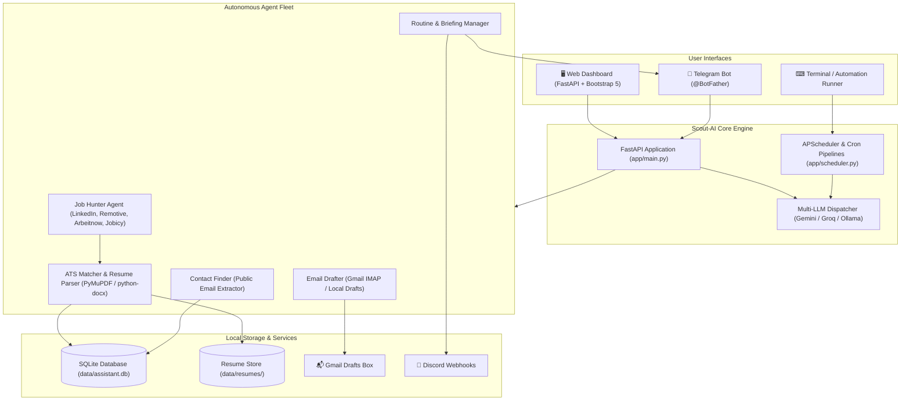

<div align="center">

# 🚀 Scout-AI: Autonomous Job Hunter & Personal AI Agent

**Your intelligent, local-first co-pilot for automated tech job aggregation, ATS resume matching, cold email drafting, and daily productivity.**

[](https://www.python.org/)
[](https://fastapi.tiangolo.com/)
[](https://aistudio.google.com/)
[](https://groq.com/)
[](https://ollama.com/)
[](./LICENSE)
[](./CONTRIBUTING.md)

[Features](#-key-features) •
[Architecture](#-system-architecture) •
[Quickstart](#-getting-started) •
[LLM Providers](#-llm-provider-options) •
[Telegram Bot](#-mobile-telegram-bot-integration) •
[Configuration](#-configuration-reference) •
[API Docs](#-api-endpoints) •
[Contributing](#-contributing)

</div>

---

## 📌 Overview

**Scout-AI** is a production-ready, autonomous personal productivity and career assistant. It automatically scours top remote and regional job feeds, extracts technical keywords from your uploaded resume, calculates ATS match compatibility scores, uncovers public recruiter email contacts, crafts bespoke tailored application drafts directly to your Gmail Drafts folder, and sends morning briefings via Telegram and Discord.

Designed to be **100% private, local-first, and flexible**, Scout-AI operates without paid subscription barriers. You can run it completely offline with **local Ollama** or tap into ultra-fast cloud inference with **Google Gemini Flash** or **Groq Cloud**.

---

## ✨ Key Features

### 🔍 1. Autonomous Multi-Source Job Hunter
- **Live Aggregation**: Fetches tech job listings from **LinkedIn Guest Scraping**, **Remotive**, **Arbeitnow**, **Jobicy**, and optionally **JSearch / RapidAPI** (aggregating Indeed, Glassdoor, and Wellfound).
- **Target Role Filtering**: Automatically isolates roles for MERN Stack, Full Stack, Backend, Frontend, Python, Java, Node.js, and Software Engineering.
- **Smart Deduplication & Expiry**: Avoids stale listings and auto-cleans unreviewed postings based on customizable timeframes (`JOB_EXPIRY_HOURS`).

### 📄 2. Dynamic Resume ATS Matching & Scoring Engine
- **Multi-Format Parsing**: Extracts structured text and skills from **PDF**, **DOCX**, and **TXT** files.
- **Resume Switcher**: Upload multiple candidate resumes or switch profiles on the fly.
- **Automated Re-Scoring**: When a new resume is activated, the entire job database dynamically recalculates ATS compatibility percentages.

### ✉️ 3. 1-Click Cold Email Drafter & Gmail Integration
- **Context-Aware Email Generation**: The LLM analyzes the specific job description alongside your actual resume facts to draft targeted, professional cover letters (no hallucinated experience).
- **Direct Gmail IMAP Drafts**: Automatically drops drafted outreach emails into your actual **Gmail Drafts folder** using free Google App Passwords—ready for review and single-click sending.
- **Local Fallback**: Automatically creates backup timestamped draft files under `data/drafts/`.

### 🔎 4. Recruiter Contact Discovery
- **Autonomous Scraper**: Scrapes public job postings and company careers pages to detect recruiter and hiring manager emails with source tracking.

### 📱 5. Bidirectional Telegram Mobile Bot
- **Full Remote Control**: Check top matches (`/jobs`), trigger live job hunts (`/hunt`), and review habits/tasks right from your smartphone.
- **Mobile Resume Upload**: Attach and send a PDF or DOCX file directly in the Telegram chat to update your active resume and recalculate scores instantly!

### 🔔 6. Multi-Channel Notifications & Scheduling
- **Daily Autonomous Briefings**: APScheduler triggers morning runs delivering top matched opportunities, pending habits, and daily tasks.
- **Discord Webhooks & Desktop Alerts**: Native Windows toast notifications and formatted Discord channel webhooks.
- **GitHub Actions 24/7 Automation**: Includes a ready-to-use `.github/workflows/daily_agent.yml` pipeline that can execute scheduled runs autonomously in the cloud for free.

### 🧩 7. Modular Extensible Plugin System
- Easily drop custom modules into `app/plugins/` with a standard `run()` interface.
- Built-in plugins include:
  - **Weather Plugin**: Free hyperlocal weather forecasts via Open-Meteo.
  - **GitHub Tracker**: Monitors repository stars, open issues, and pull requests.

---

## 🏗 System Architecture



---

## ⚡ Getting Started

### 📋 Prerequisites
- **Python 3.10 or higher**
- Git installed on your system
- (Optional) Free API key from [Google AI Studio](https://aistudio.google.com/) or [Groq Cloud](https://console.groq.com/keys), or [Ollama](https://ollama.com/) for local models.

### 💻 Installation

#### 1. Clone the Repository
```bash
git clone https://github.com/Durgesh1008/Scout-AI.git
cd Scout-AI
```

#### 2. Set Up Virtual Environment

**Windows (PowerShell):**
```powershell
python -m venv .venv
.\.venv\Scripts\Activate.ps1
```

**macOS / Linux:**
```bash
python3 -m venv .venv
source .venv/bin/activate
```

#### 3. Install Dependencies
```bash
pip install --upgrade pip
pip install -r requirements.txt
```

#### 4. Configure Environment Variables
Copy the template configuration file:
```bash
# Windows
Copy-Item .env.example .env

# macOS / Linux
cp .env.example .env
```
Edit `.env` in your preferred editor to add your chosen API keys and preferences (see [Configuration Reference](#-configuration-reference)).

---

## 🧠 LLM Provider Options

Scout-AI supports three interchangeable inference engines:

| Provider | Model | Setup & Cost | Best For |
|---|---|---|---|
| **Google Gemini** *(Recommended)* | `gemini-1.5-flash` / `gemini-2.0-flash` | Free tier (15 RPM / 1M TPM) via [Google AI Studio](https://aistudio.google.com/) | Best balance of speed, intelligence, and large context |
| **Groq Cloud** | `llama-3.3-70b-versatile` | Free tier (30 RPM) via [console.groq.com](https://console.groq.com/keys) | Near-instantaneous response times |
| **Ollama** | `llama3.2` / `mistral` | 100% Free, local & offline via [ollama.com](https://ollama.com) | Air-gapped privacy without any external API calls |

To switch models, simply update `LLM_PROVIDER` in your `.env`:
```env
LLM_PROVIDER=gemini   # Options: gemini | groq | ollama
```

---

## 🏃 Running Scout-AI

### Start the Web Dashboard
```bash
uvicorn app.main:app --reload --host 127.0.0.1 --port 8000
```
Open your browser and navigate to:
```
http://127.0.0.1:8000
```

### Run the Telegram Mobile Bot
In a separate terminal:
```bash
python -m app.telegram_bot
```

### Trigger a Job Hunt or Briefing Manually via CLI
```bash
# Execute morning briefing immediately
python -m app.scheduler --now
```

---

## 📱 Mobile Telegram Bot Integration

Control your entire job search workflow directly from your smartphone:

1. Open Telegram and search for **[@BotFather](https://t.me/BotFather)**.
2. Send `/newbot` and follow the prompts to get your `TELEGRAM_BOT_TOKEN`.
3. Start a chat with your new bot and get your Chat ID by chatting with **[@userinfobot](https://t.me/userinfobot)**.
4. Add the token and ID to `.env`:
   ```env
   TELEGRAM_BOT_TOKEN=your_token_here
   TELEGRAM_CHAT_ID=your_chat_id_here
   ```
5. Run `python -m app.telegram_bot`.
6. **Commands Available:**
   - `/start` — View interactive command menu
   - `/jobs` — View top matched job opportunities
   - `/hunt` — Trigger real-time search across job feeds
   - `/briefing` — Receive an instant morning summary
   - `/resume` — Inspect currently active resume and detected skills
   - 📎 **File Attachment** — Simply send any `.pdf` or `.docx` resume directly in chat to activate it!

---

## ⚙️ Configuration Reference

All settings can be customized in `.env`:

| Parameter | Default | Description |
|---|---|---|
| `APP_NAME` | `Scout-AI` | Display name of the web interface |
| `LLM_PROVIDER` | `gemini` | Active inference provider (`gemini`, `groq`, or `ollama`) |
| `GEMINI_API_KEY` | `""` | Google AI Studio Gemini API Key |
| `GEMINI_MODEL` | `gemini-1.5-flash` | Gemini model variant |
| `GROQ_API_KEY` | `""` | Groq Cloud API Key |
| `GROQ_MODEL` | `llama-3.3-70b-versatile` | Groq LLaMA model variant |
| `OLLAMA_BASE_URL` | `http://localhost:11434` | Endpoint for local Ollama daemon |
| `OLLAMA_MODEL` | `llama3.2` | Local model name in Ollama |
| `DATABASE_URL` | `sqlite:///./data/assistant.db` | SQLite database URI |
| `RESUME_PATH` | `./data/resume.pdf` | Active resume path for scoring & email drafts |
| `CSV_TRACKER_PATH` | `./data/job_tracker.csv` | Filepath for exported CSV job tracking records |
| `MATCH_THRESHOLD` | `35` | Minimum ATS match score (0-100) to keep a job |
| `DAILY_JOB_LIMIT` | `70` | Maximum new listings per hunt cycle |
| `TARGET_ROLES` | `MERN, Backend, Full Stack...` | Comma-delimited list of target engineering roles |
| `JOB_LOCATION_PREFERENCE`| `India + Remote` | Geographical location filters |
| `JOB_EXPIRY_HOURS` | `18` | Hours before untouched listings are auto-archived |
| `GMAIL_USER` | `""` | Gmail address for auto-drafting applications |
| `GMAIL_APP_PASSWORD` | `""` | 16-character Google App Password (not your Gmail login password) |
| `TELEGRAM_BOT_TOKEN` | `""` | Telegram Bot API token |
| `TELEGRAM_CHAT_ID` | `""` | Telegram destination chat ID |
| `DISCORD_WEBHOOK_URL` | `""` | Discord channel webhook URL |
| `ENABLE_DESKTOP_NOTIFICATIONS`| `True` | Enable native OS toast alerts |
| `MORNING_TIME` | `08:00` | Automated daily morning briefing time (24h format) |
| `TIMEZONE` | `Asia/Kolkata` | Local timezone identifier |

---

## 📡 API Endpoints

Scout-AI exposes a modular REST API built on FastAPI:

| Method | Endpoint | Description |
|---|---|---|
| `GET` | `/` | Web dashboard |
| `GET` | `/api/health` | Service health & LLM connection status |
| `GET` | `/api/jobs` | Paginated job listings with keyword and status filters |
| `POST` | `/api/jobs/hunt` | Trigger active job search across all sources |
| `POST` | `/api/jobs/{id}/status` | Update job lifecycle status (`Applied`, `Interview`, `Archived`) |
| `POST` | `/api/jobs/{id}/draft` | Generate LLM draft & sync to Gmail Drafts |
| `POST` | `/api/jobs/{id}/contacts` | Discover recruiter contact emails for a listing |
| `GET` | `/api/resumes` | List all discovered and uploaded resume files |
| `POST` | `/api/resume` | Upload new resume (`.pdf`, `.docx`, `.txt`) & re-score jobs |
| `POST` | `/api/resume/select` | Switch active resume profile |
| `POST` | `/api/resume/rescore` | Force full re-scoring of all saved jobs |
| `POST` | `/api/briefing` | Generate comprehensive morning briefing |
| `POST` | `/api/chat` | Chat with Scout-AI agent using tool execution |
| `POST` | `/api/tasks` | Create a new task item |
| `POST` | `/api/tasks/{id}/complete` | Mark task as finished |
| `POST` | `/api/habits/{id}` | Toggle daily habit completion status |
| `GET` | `/api/plugins` | List registered plugin extensions |
| `POST` | `/api/plugins/{name}/run` | Execute a specific plugin task |

---

## 📂 Project Structure

```
Scout-AI/
├── .github/
│   └── workflows/
│       └── daily_agent.yml        # Autonomous GitHub Actions daily scheduler
├── app/
│   ├── agents/
│   │   ├── contact_finder.py      # Recruiter email discovery agent
│   │   ├── email_drafter.py       # Context-aware email composer & Gmail IMAP syncer
│   │   ├── job_hunter.py          # Multi-source job scraper & ATS scoring engine
│   │   ├── orchestrator.py        # Natural language chat & intent dispatcher
│   │   └── routine_manager.py     # Habits, tasks & morning briefing compiler
│   ├── plugins/
│   │   ├── base.py                # Plugin abstract base class
│   │   ├── github_tracker.py      # GitHub repo activity tracker plugin
│   │   ├── plugin_manager.py      # Dynamic plugin discovery engine
│   │   └── weather_plugin.py      # Open-Meteo weather forecast plugin
│   ├── services/
│   │   ├── llm.py                 # Multi-LLM adapter (Gemini, Groq, Ollama)
│   │   ├── notifications.py       # Telegram, Discord & Desktop notification dispatcher
│   │   └── resume.py              # PDF/DOCX text extraction utilities
│   ├── config.py                  # Pydantic settings & environment loader
│   ├── database.py                # SQLAlchemy SQLite models & session management
│   ├── main.py                    # FastAPI application & REST routing
│   ├── scheduler.py               # APScheduler recurring task daemon
│   └── telegram_bot.py            # Long-polling Telegram mobile bot
├── data/                          # Local data directory (Git-ignored)
│   ├── drafts/                    # Locally saved email drafts
│   └── resumes/                   # User-uploaded resume store
├── static/                        # Dashboard frontend assets (JS, CSS, icons)
├── templates/                     # Jinja2 HTML templates
├── .env.example                   # Environment configuration template
├── .gitignore                     # Git ignore rules (protects credentials & resumes)
├── CONTRIBUTING.md                # Open-source contribution guidelines
├── LICENSE                        # MIT License
├── README.md                      # Project documentation & guide
└── requirements.txt               # Python package dependencies
```

---

## 🔒 Security & Privacy

- **Zero Credential Leaks**: Sensitive API tokens, private passwords, and candidate resumes are strictly excluded from version control via `.gitignore`.
- **Local-First Architecture**: Your resumes, tracked applications, personal habits, and daily notes remain stored locally in your SQLite database.
- **No Unsolicited Emails**: Scout-AI *never* sends emails automatically. It only generates drafts in your local filesystem or your personal Gmail Drafts folder for manual human review and dispatch.

---

## 🤝 Contributing

Contributions make the open-source community thrive! Whether you're reporting a bug, proposing new job feed scrapers, or adding new LLM providers:

1. **Fork** the Project.
2. Create your Feature Branch (`git checkout -b feature/AmazingFeature`).
3. Commit your Changes (`git commit -m "Add some AmazingFeature"`).
4. Push to the Branch (`git push origin feature/AmazingFeature`).
5. Open a **Pull Request**.

See [CONTRIBUTING.md](./CONTRIBUTING.md) for full details and coding standards.

---

## 📄 License

Distributed under the **MIT License**. See [`LICENSE`](./LICENSE) for full details.

---

## 🌟 Support & Acknowledgements

If you find **Scout-AI** useful in your career journey or productivity routine, please consider giving it a ⭐️ on [GitHub](https://github.com/Durgesh1008/Scout-AI)!

- Built with [FastAPI](https://fastapi.tiangolo.com/)
- Powered by [Google Gemini](https://aistudio.google.com/), [Groq](https://groq.com/), and [Ollama](https://ollama.com/)
- UI powered by [Bootstrap 5](https://getbootstrap.com/) & [FontAwesome](https://fontawesome.com/)
