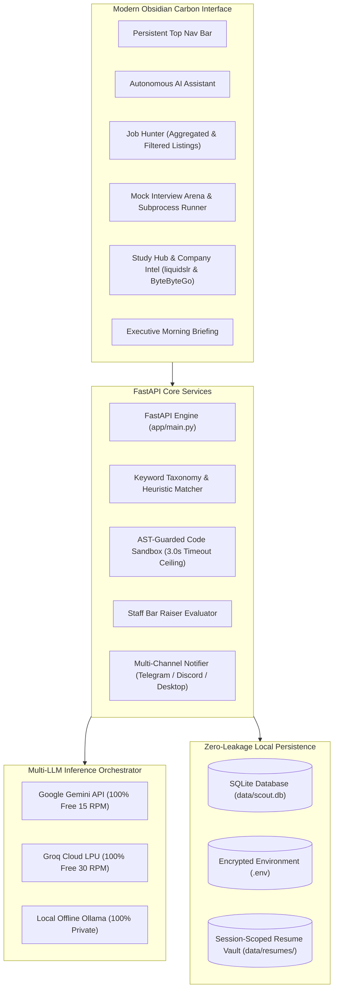

# ⚡ SCOUT-AI — Autonomous Career & Mock Interview Studio

<div align="center">

[](https://www.python.org/)
[](https://fastapi.tiangolo.com/)
[](https://www.sqlite.org/)
[](https://getbootstrap.com/)
[](./LICENSE)

**An autonomous, local-first engineering studio combining 7-source job intelligence, keyword taxonomy & heuristic CV matching, an AST-guarded sandboxed code compiler, 4-metric Staff Bar Raiser evaluations, and automated multi-channel dispatch.**

[System Architecture (ARCHITECTURE.md)](./ARCHITECTURE.md) • [Quick Start](#-quick-start) • [Environment Secrets (.env)](#-environment-variables--zero-leakage-policy) • [Contributing](#-contributing)

</div>

---

## 📌 Architecture Overview



For the comprehensive technical specification, see **[ARCHITECTURE.md](./ARCHITECTURE.md)**.

---

## ✨ Key Capabilities

### 1. 💼 Autonomous Job Hunter & Multi-Channel Pipeline
- **7 Direct & Aggregated Sources:** LinkedIn India, JSearch Aggregator (aggregates startup & corporate listings), Himalayas (startup tech ecosystem), WeWorkRemotely, Remotive, Arbeitnow, and Jobicy. *(Startup ecosystem queries like AngelList/Wellfound are retrieved via aggregator feeds rather than an unverified direct API).*
- **Complete Multi-User Session Isolation:** Candidate resumes, personal match percentages, application status tracking (`Interested`, `Applied`, `Interview`), daily tasks, and habit streaks are strictly isolated per user session via secure HTTP cookies (`scout_session_id`) and Telegram chat scopes (`tg_{chat_id}`). Uploads and re-scoring never mutate global environment variables or shared server state.
- **Keyword Taxonomy & Semantic Skill Matching:** Accurately extracts technical competencies and dynamic experience levels using an extensible tech taxonomy and temporal date-range heuristics, prioritizing India & worldwide remote roles.
- **Transparent Recruiter Contact Classification:** Every recruiter address is explicitly verified and labeled into one of three tiers:
  - 🟢 **Published and extracted:** Extracted directly from the original job listing.
  - 🔵 **Verified mailbox:** Standard corporate career/talent inbox (`careers@`, `talent@`, `recruiting@`).
  - 🟡 **Generated pattern — unverified:** Algorithmic email guess (`firstname.lastname@domain.com`).
- **18-Hour Auto-Clean (IST):** Automatically expires and purges unreviewed listings to prevent stale backlogs.
- **Cold Outreach Drafter:** Generates personalized STAR cold emails saved directly into your Gmail Drafts via IMAP.

### 2. ⚡ Live Mock Interview Arena & Sandbox Compiler
- **Verified Question Archive:** Pulls FAANG & Unicorn questions directly from the verified `liquidslr` company repository (Swiggy, NatWest, Google, Amazon, Meta).
- **System Design 101:** Integrated real-world architectural design challenges from `ByteByteGo 101`.
- **Multi-Tier Sandboxed Code Execution:** Hardened pre-execution AST static analysis blocks unauthorized system calls and reflection breakouts (`__class__`, `__subclasses__`, `__mro__`, `__globals__`). Executes Python with `-I -B` and poisoned network modules (`socket = None`); runs Node.js with `--no-addons`, `--disallow-code-generation-from-strings`, and a 64MB memory ceiling; enforces POSIX kernel `RLIMIT` limits on Linux/Docker; and supports zero-trust disposable Docker micro-containers via `SANDBOX_MODE=docker`.
- **Staff Bar Raiser Grading:** Evaluates code across 4 dimensions: Technical Depth (1-10), Missing Keywords, STAR approach, and 10/10 Staff Model Code.

### 3. ☀️ Executive Morning Briefing & Routine Manager
- **Default 9:00 AM IST Schedule:** Scheduled daily at `09:00` IST (`03:30 UTC` in GitHub Actions) to synthesize your **Top 5 Priority Tasks**, **Habit Protocol**, and **Top Matched Jobs**.
- Multi-channel dispatch to **Telegram**, **Discord Webhook**, and native **Windows Toast Notifications**.

### 4. 🤖 Telegram Mobile Controller & Asynchronous Gateway
- **Remote Mobile Control:** Manage your job pipeline, check tasks, and practice technical interviews directly from your smartphone.
- **Session-Isolated CV Upload:** Attach and send any `.pdf` or `.docx` resume file directly to the bot. It automatically saves to your private vault `data/resumes/tg_{chat_id}/`, parses key skills, and re-scores your jobs without touching `.env`.
- **Private Task Checklist:** Use `/tasks` to view your personal daily todos and `/add <task>` to add new goals on the go.
- **Mobile Mock Interviews:** Execute `/mock swiggy` or `/mock google` to receive verified technical questions, then reply `answer: <your code/explanation>` for instant 4-metric Staff Bar Raiser grading.
- **Company Intelligence:** Query `/company swiggy` or `/company natwest` for round breakdowns, tech grilling areas, and real past interview questions.
- **Autonomous Triggers:** Send `/hunt` to discover new jobs, `/jobs` to view ranked listings, or `/run` to trigger the full morning pipeline.

### 5. 🎨 Obsidian Carbon Design System
- High-contrast, production-grade interface designed to the standards of Linear and Raycast.
- Hairline borders, glowing emerald/cyan status capsules, and fully responsive navigation across desktop, laptop, tablet, and mobile.

---

## 🚀 Quick Start

### 1. Clone & Set Up Virtual Environment

```powershell
# Clone the repository
git clone https://github.com/Durgesh1008/Scout-AI.git
cd Scout-AI

# Create virtual environment
python -m venv .venv

# Activate (Windows PowerShell)
.\.venv\Scripts\Activate.ps1

# Activate (macOS / Linux)
# source .venv/bin/activate

# Install dependencies
pip install -r requirements.txt
```

### 2. Configure Environment Secrets

Copy `.env.example` to `.env`:

```powershell
Copy-Item .env.example .env     # Windows PowerShell
# cp .env.example .env           # macOS / Linux
```

Open `.env` in your editor and enter your free API keys (see table below).

### 3. Start the Server

```powershell
python -m uvicorn app.main:app --reload --port 8000
```

Open **`http://localhost:8000`** in your browser.

### 4. (Optional) Start the Telegram Mobile Controller

If you configured `TELEGRAM_BOT_TOKEN` in `.env`, launch the background mobile controller daemon:

```powershell
python -m app.telegram_bot
```

You can now command Scout-AI, upload PDF resumes, receive morning push briefings, and simulate mock interviews directly from your Telegram mobile app!

---

## 🔐 Environment Variables & Zero-Leakage Policy

> **IMPORTANT:** Never commit your `.env` file or personal resumes to Git. Scout-AI is configured with strict `.gitignore` rules to keep all secrets on your local machine.

| Variable | Required? | Default | Description |
| :--- | :---: | :---: | :--- |
| `LLM_PROVIDER` | Optional | `gemini` | `gemini`, `groq`, or `ollama` |
| `GEMINI_API_KEY` | Optional | `""` | Free Google Gemini key ([Google AI Studio](https://aistudio.google.com/)) |
| `GEMINI_MODEL` | Optional | `gemini-2.5-flash` | Gemini model name |
| `GROQ_API_KEY` | Optional | `""` | Free Groq key ([Groq Console](https://console.groq.com/keys)) |
| `GROQ_MODEL` | Optional | `llama-3.3-70b-versatile` | Ultra-fast Groq model |
| `OLLAMA_BASE_URL`| Optional | `http://localhost:11434` | Local Ollama endpoint |
| `DATABASE_URL` | Optional | `sqlite:///./data/assistant.db` | Local SQLite database path |
| `RESUME_PATH` | Optional | `./data/resume.pdf` | Path to active candidate resume |
| `MATCH_THRESHOLD`| Optional | `35` | Minimum match percentage for job recommendations |
| `GMAIL_USER` | Optional | `""` | Gmail address for saving outreach drafts |
| `GMAIL_APP_PASSWORD`| Optional | `""` | 16-character Google App Password |
| `TELEGRAM_BOT_TOKEN`| Optional | `""` | Telegram Bot token via [@BotFather](https://t.me/BotFather) |
| `TELEGRAM_CHAT_ID` | Optional | `""` | User Telegram chat ID |
| `DISCORD_WEBHOOK_URL`| Optional | `""` | Discord channel webhook URL |
| `RAPIDAPI_KEY` | Optional | `""` | Optional JSearch aggregation key |
| `MORNING_TIME` | Optional | `09:00` | Default morning pipeline trigger time (IST) |
| `TIMEZONE` | Optional | `Asia/Kolkata` | Scheduler timezone |
| `SANDBOX_MODE` | Optional | `isolated_subprocess` | `isolated_subprocess` or `docker` (container microVM) |

---

## 🛡️ Pre-Commit Safety Checklist (Before Pushing to GitHub)

Before running `git push`, verify that no secrets or personal files are staged:

```powershell
# 1. Verify git status has NO .env, .pdf, or .db files
git status

# 2. Verify tracked changes do NOT contain raw API keys
git diff --staged

# 3. Ensure test suite passes
python -c "from app.config import settings; print('Config loaded successfully!')"
```

---

## 📂 Project Structure

```
Scout-AI/
├── .env.example                 # Public environment configuration template
├── .gitignore                    # Zero-leakage git ignore rules
├── ARCHITECTURE.md               # Industry-level engineering documentation
├── README.md                     # Repository documentation
├── requirements.txt              # Production Python dependencies
├── app/
│   ├── config.py                 # Pydantic Settings & environment validation
│   ├── database.py               # SQLite & SQLAlchemy engine setup
│   ├── main.py                   # FastAPI REST API & routes
│   ├── models.py                 # Database ORM models
│   ├── agents/                   # Autonomous agent micro-services
│   │   ├── job_hunter.py         # 8-source crawler & scoring
│   │   ├── resume_matcher.py     # Semantic TF-IDF & LLM matching
│   │   └── routine_manager.py    # Daily briefings, habits, tasks
│   └── services/                 # Studio execution services
│       ├── code_runner.py        # Sandboxed Python & Node.js runner
│       ├── mock_interview.py     # liquidslr company question provider
│       └── prep_lab.py           # ByteByteGo 101 & track roadmaps
├── static/
│   ├── app.js                    # SPA application state & client logic
│   ├── style.css                 # Obsidian Carbon theme & responsive styles
│   └── manifest.json             # PWA web manifest
└── templates/
    └── index.html                # Single-page web dashboard
```

---

## 📄 License

This project is licensed under the MIT License — see the [LICENSE](./LICENSE) file for details.
